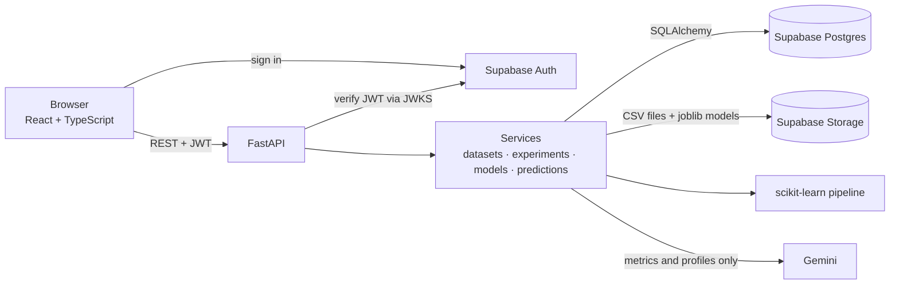

# MLens

**Discover, train, compare, and understand.**

MLens is an end-to-end machine-learning experimentation platform. Upload a CSV (or start from a curated public dataset), train scikit-learn models, compare runs, read AI explanations grounded in the actual metrics, and use saved models to make predictions on new data.

The ML pipeline is the source of truth. Gemini only explains results the pipeline has already produced; it never generates the metrics.

```text
Discover → Dataset → Experiment → Model → Prediction
```

## Features

- **Discover (no account needed):** curated, openly licensed datasets with descriptions, sources, a data preview, column profiles and example experiments. Public experiments and comparisons can be viewed signed-out.
- **Datasets:** CSV upload (up to 10 MiB), profiling (types, missing values, duplicates), cleaning into a new copy, public/private visibility.
- **Experiments:** classification and regression with Logistic/Linear Regression, Decision Tree, Random Forest and Gradient Boosting. Preprocessing (imputation, scaling, one-hot encoding) runs inside the pipeline, so the test split stays clean.
- **Compare:** side-by-side metrics for runs on the same dataset and target, with warnings when the comparison isn't like for like.
- **AI, in context:** explain a dataset, explain results, explain a comparison, suggest the next experiment. Suggestions are validated against the supported algorithms and parameter ranges before they're shown. AI needs sign-in.
- **Models and predictions:** save the fitted pipeline (joblib), run it on new data, and download predictions as CSV. Public models can be used by other signed-in users on their own data.
- **Auth and ownership:** Supabase Auth. Every request is checked on the server; private items return 404 to anyone else.

## Architecture



**Request flow:** React page → FastAPI router (auth and ownership checks) → service → Postgres / Storage / scikit-learn / Gemini → JSON or CSV response.

| Layer | Tech |
|---|---|
| Frontend | React 18, TypeScript, Vite, React Router, supabase-js |
| API | FastAPI, Pydantic, PyJWT |
| Data | SQLAlchemy, Supabase Postgres, Supabase Storage |
| ML | pandas, scikit-learn, joblib |
| AI | Gemini via `google-genai`, structured JSON output validated with Pydantic |
| Tests | pytest, FastAPI TestClient |

## Project structure

```text
backend/
  main.py                 FastAPI app and routers
  auth/                   Supabase JWT verification, ownership and read-access checks
  features/
    dataset/ experiment/ model/ prediction/ user/ explore/   routers, schemas, services
    ai/                   Gemini client, prompts, output validation, error mapping
  services/               ML pipeline, dataset analysis and cleaning, model options
  storage/                Supabase Storage access and cleanup of orphaned files
  database/migrations/    SQL to run in Supabase (001–003)
  scripts/seed_discover.py + discover_data/   curated public datasets
frontend/                 React app (see frontend/README.md)
tests/                    pytest suite (no real Supabase or Gemini needed)
```

## Running locally

### Prerequisites
Python 3.13, Node 22, and a Supabase project (Postgres, Storage and Auth) plus a Gemini API key.

### 1. Backend
```bash
python -m venv .venv && source .venv/bin/activate
pip install -r requirements.txt
```

Create `.env` in the project root:
```bash
DATABASE_URL=postgresql+psycopg://...          # Supabase Postgres connection string
SUPABASE_URL=https://<project-ref>.supabase.co
SUPABASE_SECRET_KEY=...                         # server only; never put this in the frontend
GEMINI_API_KEY=...
# Optional:
# SUPABASE_JWT_SECRET=...   only for projects still using the legacy HS256 JWT secret
# CORS_ORIGINS=https://your-frontend.example.com
```

Set up the database:
1. Create the tables: `python -m backend.database.create_tables`
2. In the Supabase SQL editor, run `backend/database/migrations/001`, `002` and `003` in order.
3. In Supabase Storage, create private buckets `datasets`, `models` and `prediction-results`.
4. Load the curated Discover datasets and example experiments: `python -m backend.scripts.seed_discover`

Start the API (docs at http://127.0.0.1:8000/docs):
```bash
uvicorn backend.main:app --reload
```

### 2. Frontend
```bash
cd frontend
cp .env.example .env   # set VITE_SUPABASE_URL and VITE_SUPABASE_PUBLISHABLE_KEY
npm install
npm run dev            # http://localhost:5173
```
In development, Vite proxies `/api` to the backend, so no CORS setup is needed.

In Supabase Auth settings, keep **Confirm email** on and add `http://localhost:5173/**` to the redirect URLs.

## Tests

```bash
pip install -r requirements-dev.txt
pytest
```

39 tests covering the critical flows: upload, training, model save/load, prediction, comparison, AI endpoint validation and access control. They run in a few seconds with no real services: SQLite instead of Postgres, in-memory storage, locally signed JWTs and a faked Gemini.

## API overview

Full interactive docs are at `/docs`. Main groups:

| Area | Endpoints |
|---|---|
| Account | `GET/PATCH /users/me` |
| Datasets | `GET/POST /datasets`, `GET/PATCH/DELETE /datasets/{id}`, `/inspect`, `/preview`, `/download`, `/clean`, `/copy`, `/explanation` |
| Experiments | `GET /experiments`, `GET/PATCH/DELETE /experiments/{id}`, `/explanation`, `/recommendations`, `POST /experiments/compare`, `/compare/explanation` |
| Models | `GET /models/options`, `POST /models/train`, `GET /models`, `GET/DELETE /models/{id}` |
| Predictions | `GET/POST /predictions`, `GET/DELETE /predictions/{id}`, `/download` |
| Discover | `GET /explore/datasets`, `/explore/experiments`, `/explore/models`, `/explore/stats` (no sign-in needed) |

## Security notes

- The frontend only ever holds the Supabase **publishable** key. The secret key, database URL and Gemini key stay on the server.
- Row-level security is enabled on all tables with no policies, so Supabase's public Data API can't read them. FastAPI connects directly as the table owner.
- Signed-out visitors can only read public items. Uploads, training, downloads, predictions and every AI call require sign-in.
- AI prompts receive dataset profiles and metrics, never raw dataset rows.

## Licence of bundled data

The curated datasets in `backend/scripts/discover_data/` come from the UCI Machine Learning Repository (CC BY 4.0), the palmerpenguins package (CC0), scikit-learn and vega-datasets. Each dataset's source is listed in `manifest.json` and shown on its Discover page.
